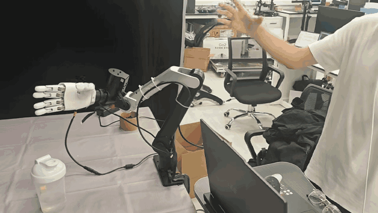

# O10 HTS Teleop

**Bare-hand teleoperation for OmniHand 2025 O10 with Meta Quest 3 and Hand Tracking Streamer.**

**English** | [简体中文](README_zh-CN.md)

[Demo](#demo) · [Installation](#installation) · [Device setup](#device-setup) · [Teleoperation](#teleoperation) · [Recording](#recording) · [Troubleshooting](#troubleshooting)

This project adapts dex-retargeting's DexPilot implementation to the O10's ten active joints, joint order, limits, and nonlinear finger coupling. It supports a left or right O10, finger-extension and closed-fist assistance, latest-frame processing, tracking-loss recovery, and a local status/recording page.

## Demo

[](https://raw.githubusercontent.com/JiaCheng310/o10-hts-teleop/main/assets/o10-hts-demo.mp4)

[Watch the full video with audio (720p, 30 FPS)](https://raw.githubusercontent.com/JiaCheng310/o10-hts-teleop/main/assets/o10-hts-demo.mp4).

## Overview

```text
Quest 3 native hand tracking → HTS → USB / ADB reverse
                                        ↓
                              DexPilot + O10 adaptation
                                        ↓
                                  O10 USB SDK
```

Hand tracking runs on the Quest. No external camera, hand-pose model download, model training, or discrete GPU is required. The commands in this guide control **one O10 hand** and do not start an arm controller.

## Requirements

| Component | Configuration |
|---|---|
| Host | Ubuntu 24.04, x86_64, Python 3.12 |
| Headset | Meta Quest 3, developer mode and USB debugging enabled |
| Robot hand | OmniHand 2025 O10, left or right, with separate power |
| Connections | Both Quest and O10 connected to the same host by USB |
| Retargeting | Included O10-modified dex-retargeting 0.5.0 |
| SDK | OmniHand 1.1.8 for CPython 3.12 / Linux x86_64 |
| HTS | Pinned 1.1.0 APK; see [asset setup](docs/assets.md) |

The launcher and SDK wheel target Linux. A Mac can edit the project and view a forwarded status page; this guide does not install the Linux hand driver on macOS.

## Installation

Run commands on the **Ubuntu host connected to the devices**. Clone the repository first; if you already have a copy, enter that directory instead.

```bash
sudo apt update
sudo apt install -y git
mkdir -p ~/project
cd ~/project
git clone https://github.com/JiaCheng310/o10-hts-teleop.git
cd o10-hts-teleop
```

### 1. Install system packages

```bash
cd ~/project/o10-hts-teleop
sudo apt update
sudo apt install -y python3.12 python3.12-venv python3-pip adb ffmpeg curl nano libusb-1.0-0
```

### 2. Check the SDK and robot models

The SDK, APK, and manufacturer models are supplied separately. Follow [Asset setup / 依赖文件准备](docs/assets.md), then check the required files:

```bash
ls dependencies/omnihand/omnihand-1.1.8-cp312-cp312-linux_x86_64.whl
ls dependencies/hts/hand_tracking_streamer.apk
ls vendor/omnihand_description-omnihandT2_1/assets/urdf/omnihand_{left,right}.urdf
ls vendor/omnihand_description-omnihandT2_1/assets/MJCF/omnihand_{left,right}.xml
```

All six paths must exist. Keep the model's `meshes/` directory too. The MJCF files provide coupling coefficients, even though this pipeline does not run MuJoCo.

### 3. Create the Python environment

```bash
python3.12 -m venv .venv
source .venv/bin/activate
python -m pip install --upgrade pip
python -m pip install torch==2.8.0+cpu --index-url https://download.pytorch.org/whl/cpu
python -m pip install -r requirements.txt
python -m pip install --no-deps -e third_party/dex-retargeting
python -m pip install dependencies/omnihand/omnihand-1.1.8-cp312-cp312-linux_x86_64.whl
python -m pip check
```

The final command should print `No broken requirements found.` Use the included dex-retargeting source: the stock PyPI package lacks this project's O10 configuration and coupling adapter.

### 4. Validate without hardware

```bash
python scripts/check_install.py
bash scripts/test_offline.sh
```

Expected installation output:

```text
left: DexPilot + O10 coupling + 10 SDK joints OK
right: DexPilot + O10 coupling + 10 SDK joints OK
SDK import OK. No device was opened and no motor command was sent.
```

The test suite should finish with `OK`. It covers HTS parsing, hand selection, tracking loss/recovery, mock driver transmission, and recording ownership. Tests use simulated frames and drivers; they do not measure physical latency. Fresh-environment validation is recorded in [VALIDATION.md](docs/VALIDATION.md).

## Device setup

### 5. Authorize USB and identify your devices

Enable developer mode for the Quest, connect it by USB, put on the headset, and accept **Allow USB debugging** for this computer. Connect and power the O10, then run:

```bash
python scripts/list_devices.py
cp -n config/devices.env.example config/devices.env
nano config/devices.env
```

The Quest must have status `device`, not `unauthorized` or `offline`. The script prints the O10 serial identifier separately from the full serial-port path. Replace the following example values with your identifiers; leave an unused hand side empty:

```dotenv
QUEST_SERIAL=YOUR_QUEST_SERIAL
O10_RIGHT_SERIAL=YOUR_RIGHT_O10_SERIAL
O10_LEFT_SERIAL=
```

USB enumeration cannot determine whether a physical O10 is left or right. Check the hand before assigning its identifier.

### 6. Grant serial access

```bash
sudo usermod -aG dialout "$USER"
```

Log out of Ubuntu and log back in. In a new terminal:

```bash
cd ~/project/o10-hts-teleop
id -nG
```

The output must include `dialout`. The launcher automatically uses `.venv/bin/python`; environment activation is optional for subsequent `bash scripts/teleop.sh ...` commands.

### 7. Install HTS on the Quest

```bash
set -a
source config/devices.env
set +a
adb -s "$QUEST_SERIAL" install -r dependencies/hts/hand_tracking_streamer.apk
adb -s "$QUEST_SERIAL" shell pm path com.wengmister.handtrackingstreamer
```

Expect `Success`, followed by an APK path. The launcher will open HTS when a preview or real-hand session starts.

## Teleoperation

### 8. Preview the right hand first

Ubuntu, Terminal 1:

```bash
bash scripts/teleop.sh right preview-check
bash scripts/teleop.sh right preview
```

In HTS, set the following and click **Start Streaming**:

| Setting | Value |
|---|---|
| Transport | `TCP - wired` |
| Host / port | `127.0.0.1` / `8000` |
| Hand | `Right` |
| Debug Info | **On**, required for frame IDs and timestamps |
| Show Landmarks | **On**, shows joint coordinate axes in the headset |
| Video | Off |
| Head Pose | Off for hand-only operation |

**Keep Quest connected to Wi-Fi.** The pinned APK checks for an active network even in wired mode; hand data still travels over USB. The available network-gate source patch has not been rebuilt into this APK. Recheck Debug Info and Show Landmarks after reopening HTS.

Open **[http://127.0.0.1:8042](http://127.0.0.1:8042)** on Ubuntu. Expect `mode: preview`, an increasing frame count, and changing `o10_angles_rad` in the diagnostics. Preview computes joint targets; the webpage is a status panel, not a rendered O10 simulator. Joint axes appear inside HTS.

Ubuntu, Terminal 2, to inspect the same status as JSON:

```bash
curl -fsS http://127.0.0.1:8042/state | python3 -m json.tool
```

### 9. Start the physical right hand

Stop the preview using `Ctrl+C` in Terminal 1, or from a second terminal in the project directory:

```bash
bash scripts/teleop.sh stop
```

Then check and launch the physical device:

```bash
bash scripts/teleop.sh right check
bash scripts/teleop.sh right start
```

`check` validates dependencies, USB selection, and serial permissions without sending motor commands. **`start` enables physical output: fresh right-hand tracking can immediately move the O10 fingers.** Click Start Streaming again if HTS reopened. Expect `mode: hardware` and an increasing sent-command count on the webpage.

### 10. Use the left hand

Set `O10_LEFT_SERIAL` in `config/devices.env`, select **Left** in HTS, and run:

```bash
bash scripts/teleop.sh left preview-check
bash scripts/teleop.sh left preview
```

After checking the preview, stop it before enabling hardware:

```bash
bash scripts/teleop.sh stop
bash scripts/teleop.sh left check
bash scripts/teleop.sh left start
```

Run one side at a time. The HTS side, launcher side, configured USB identifier, and physical O10 must agree.

### 11. Pause, resume, and stop

- Pause: click `暂停全部跟随` on the webpage.
- Resume fingers: click `恢复手指跟随`.
- Tracking loss: transmission stops; fresh tracking resumes it unless you manually paused.
- Stop the session: press `Ctrl+C` in its terminal, or run:

```bash
bash scripts/teleop.sh stop
```

This stops the receiver, hand driver, and HTS app. The independent recording service may remain running; finish and save a recording before stopping the session. The hand launcher does not reset or home the O10.

## Recording

Keep Quest awake in HTS. At the bottom of the status page, click `开始录制` (start recording), then `停止并保存` (stop and save). Download the completed MP4 from the panel. The standalone recording page is **[http://127.0.0.1:8044](http://127.0.0.1:8044)**.

Saved files are on the Ubuntu host:

```bash
ls -lh teleop/output/quest_recordings/*.mp4
```

Default capture: native right-eye view, 1080×1080, target 36 FPS / 10 Mbps, no audio. This records headset video, not a synchronized robot demonstration dataset. Closing the webpage does not stop recording.

## Command reference

Run from the project directory; replace `right` with `left` when needed.

| Command | Result |
|---|---|
| `bash scripts/teleop.sh right preview-check` | Check Quest and dependencies |
| `bash scripts/teleop.sh right check` | Also check the selected O10 port and permissions |
| `bash scripts/teleop.sh right preview` | Receive HTS and compute targets without connecting O10 |
| `bash scripts/teleop.sh right start` | Start physical hand teleoperation |
| `bash scripts/teleop.sh stop` | Stop this launcher's session |
| `bash scripts/test_offline.sh` | Run offline tests |
| `bash scripts/teleop.sh --help` | Show launcher help |

For an existing Python 3.12 environment, set `O10_PYTHON=/absolute/path/to/env/bin/python` in `config/devices.env`. For offline tests, pass the override in the command environment.

## Troubleshooting

| Symptom | Check / fix |
|---|---|
| ADB `unauthorized` | Put on Quest and approve this host; rerun `adb devices -l`. |
| HTS reports no network | Connect Quest to Wi-Fi; retain the wired localhost settings. |
| No frames / axes | Enable native hand tracking, show the selected bare hand, enable Debug Info and Show Landmarks, and Start Streaming. |
| Wrong hand | Match HTS side, launcher side, physical hand, and configured serial. |
| Serial permission denied | After logging back in, confirm `id -nG` includes `dialout`. |
| Missing `RobotName.omnihand_o10` | Inside `.venv`, rerun `python -m pip install --no-deps -e third_party/dex-retargeting`. |
| Missing URDF / MJCF / mesh | Restore the complete model directory; see [asset setup](docs/assets.md). |
| Valid tracking, `mode: preview`, no movement | Stop preview and explicitly use `right start` or `left start`. |
| Tracking valid but paused | Click Resume fingers; resolve any reported driver fault first. |
| Port occupied | Stop this project's previous session; unrelated processes are not killed automatically. |
| Hand unplugged | Reconnect, run `check`, then `start`. |
| Recording panel unavailable | Check `ffmpeg -version`, Quest authorization, and the recording log. |

```bash
tail -n 80 teleop/output/hts_hardware.log
tail -n 80 teleop/output/hts_usb_right.log
tail -n 80 teleop/output/quest_recording.log
```

Use `hts_usb_left.log` for a left hand.

## Project layout

```text
config/                      Device configuration template
scripts/                     Launcher, USB listing, install check, offline tests
o10teleop/                   O10 retargeting and coupling adaptation
teleop/                      HTS receiver, USB bridge, web UI, recording
third_party/dex-retargeting/  O10-modified retargeting dependency
vendor/                      Separately supplied robot models
dependencies/                Separately supplied SDK wheel and HTS APK
tests/                       Offline tests with simulated input and drivers
docs/                        Asset setup, validation, attribution
```

X5 source is retained for separate integration; this guide and launcher focus on O10 hand teleoperation.

## License

Adapter code is released under the [MIT License](LICENSE). Third-party components retain their own licenses; see [third-party notices](docs/THIRD_PARTY_NOTICES.md).

## Acknowledgments

- [Hand Tracking Streamer](https://github.com/wengmister/hand-tracking-streamer): Quest telemetry and headset visualization.
- [dex-retargeting / AnyTeleop](https://github.com/dexsuite/dex-retargeting): retargeting framework and DexPilot implementation.
- [AGILINK OmniHand SDK](https://github.com/AgibotTech/agillink_omnihand_sdk): O10 hardware interface.

See [third-party notices](docs/THIRD_PARTY_NOTICES.md) and [validation notes](docs/VALIDATION.md).
