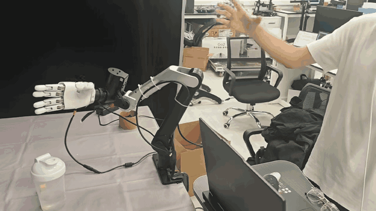

# O10 HTS Teleop

**基于 Meta Quest 3 与 Hand Tracking Streamer 的 OmniHand 2025 O10 裸手遥操适配。**

[English](README.md) | **简体中文**

[演示](#演示) · [安装](#安装) · [设备配置](#设备配置) · [开始遥操](#开始遥操) · [录屏](#录屏) · [常见问题](#常见问题)

本项目在 dex-retargeting 的 DexPilot 实现上，适配 O10 的 10 个主动关节、关节顺序、限位与非线性手指耦合。支持 O10 左右手、伸直与握拳辅助、最新帧处理、跟踪丢失恢复，以及本机状态和录屏网页。

## 演示

[](https://raw.githubusercontent.com/JiaCheng310/o10-hts-teleop/main/assets/o10-hts-demo.mp4)

[观看带声音的完整视频（720p，30 FPS）](https://raw.githubusercontent.com/JiaCheng310/o10-hts-teleop/main/assets/o10-hts-demo.mp4)。

## 工作流程

```text
Quest 3 原生裸手跟踪 → HTS → USB / ADB reverse
                                    ↓
                           DexPilot + O10 适配
                                    ↓
                               O10 USB SDK
```

手部跟踪在 Quest 上完成，无需外置相机、下载手部识别模型、训练模型或独立显卡。本教程控制**单只 O10 灵巧手**，不会启动机械臂控制器。

## 环境要求

| 项目 | 配置 |
|---|---|
| 主机 | Ubuntu 24.04、x86_64、Python 3.12 |
| 头显 | Meta Quest 3，开启开发者模式和 USB 调试 |
| 灵巧手 | OmniHand 2025 O10 左手或右手，单独供电 |
| 接线 | Quest 和 O10 均通过 USB 连接同一台主机 |
| 重定向 | 项目内含 O10 修改的 dex-retargeting 0.5.0 |
| SDK | OmniHand 1.1.8，CPython 3.12 / Linux x86_64 |
| HTS | 固定的 1.1.0 APK，见[依赖文件准备](docs/assets.md) |

启动器和 SDK wheel 面向 Linux。Mac 可以编辑项目或查看转发后的网页，本教程不在 macOS 上安装这个 Linux 实机驱动。

## 安装

以下命令在**连接 Quest 和 O10 的 Ubuntu 主机**执行。先克隆仓库；如果已有源码，直接进入对应目录。

```bash
sudo apt update
sudo apt install -y git
mkdir -p ~/project
cd ~/project
git clone https://github.com/JiaCheng310/o10-hts-teleop.git
cd o10-hts-teleop
```

### 1. 安装系统依赖

```bash
cd ~/project/o10-hts-teleop
sudo apt update
sudo apt install -y python3.12 python3.12-venv python3-pip adb ffmpeg curl nano libusb-1.0-0
```

### 2. 检查 SDK 和机器人模型

SDK、APK 和厂家模型单独提供。先按[依赖文件准备](docs/assets.md)放好文件，再检查：

```bash
ls dependencies/omnihand/omnihand-1.1.8-cp312-cp312-linux_x86_64.whl
ls dependencies/hts/hand_tracking_streamer.apk
ls vendor/omnihand_description-omnihandT2_1/assets/urdf/omnihand_{left,right}.urdf
ls vendor/omnihand_description-omnihandT2_1/assets/MJCF/omnihand_{left,right}.xml
```

上述六个文件都应存在，还需保留模型中的 `meshes/` 目录。MJCF 提供关节耦合系数；即使不运行 MuJoCo，也需要它。

### 3. 创建 Python 环境

```bash
python3.12 -m venv .venv
source .venv/bin/activate
python -m pip install --upgrade pip
python -m pip install torch==2.8.0+cpu --index-url https://download.pytorch.org/whl/cpu
python -m pip install -r requirements.txt
python -m pip install --no-deps -e third_party/dex-retargeting
python -m pip install dependencies/omnihand/omnihand-1.1.8-cp312-cp312-linux_x86_64.whl
python -m pip check
```

最后应输出 `No broken requirements found.`。必须安装项目里的 dex-retargeting；PyPI 原版没有本项目的 O10 配置和耦合适配器。

### 4. 不连接实机，先验证安装

```bash
python scripts/check_install.py
bash scripts/test_offline.sh
```

安装检查应输出：

```text
left: DexPilot + O10 coupling + 10 SDK joints OK
right: DexPilot + O10 coupling + 10 SDK joints OK
SDK import OK. No device was opened and no motor command was sent.
```

离线测试最后应显示 `OK`，覆盖 HTS 解析、左右手选择、跟踪丢失与恢复、模拟驱动发送、录屏归属检查。测试使用模拟数据和假驱动，不会驱动电机，也不代表实机延迟测试。独立新环境的验证结果见[验证记录](docs/VALIDATION.md)。

## 设备配置

### 5. 授权 USB，查询设备编号

给 Quest 开启开发者模式，通过 USB 接主机。戴上头显，在**允许 USB 调试**提示中允许这台电脑。接好 O10 数据线并给手供电，然后执行：

```bash
python scripts/list_devices.py
cp -n config/devices.env.example config/devices.env
nano config/devices.env
```

Quest 状态应为 `device`，不能是 `unauthorized` 或 `offline`。脚本会分别打印 O10 串口的编号与完整路径。把下面示例值替换为查到的编号；没有的那一侧留空：

```dotenv
QUEST_SERIAL=YOUR_QUEST_SERIAL
O10_RIGHT_SERIAL=YOUR_RIGHT_O10_SERIAL
O10_LEFT_SERIAL=
```

USB 枚举不能判断实体 O10 是左手还是右手，请以实际连接的手为准填写。

### 6. 配置串口权限

```bash
sudo usermod -aG dialout "$USER"
```

退出 Ubuntu 当前登录并重新登录，在新终端执行：

```bash
cd ~/project/o10-hts-teleop
id -nG
```

输出应包含 `dialout`。后面的 `bash scripts/teleop.sh ...` 自动使用项目的 `.venv/bin/python`，不需要每次激活环境。

### 7. 给 Quest 安装 HTS

```bash
set -a
source config/devices.env
set +a
adb -s "$QUEST_SERIAL" install -r dependencies/hts/hand_tracking_streamer.apk
adb -s "$QUEST_SERIAL" shell pm path com.wengmister.handtrackingstreamer
```

应看到 `Success`，随后显示 APK 安装路径。启动预览或实机遥操时，脚本会自动打开 HTS。

## 开始遥操

### 8. 先启动右手预览

Ubuntu 终端 1：

```bash
bash scripts/teleop.sh right preview-check
bash scripts/teleop.sh right preview
```

在头显 HTS 设置以下选项，随后点击 **Start Streaming**：

| 选项 | 设置 |
|---|---|
| 传输方式 | `TCP - wired` |
| 地址 / 端口 | `127.0.0.1` / `8000` |
| 手 | `Right` |
| Debug Info | **开启**，用于传输帧号和时间戳 |
| Show Landmarks | **开启**，在头显内显示关节坐标轴 |
| Video | 关闭 |
| Head Pose | 只控制手时关闭 |

**Quest 仍需连接 Wi-Fi。** 当前固定版本 APK 即使在有线模式也检查活动网络，但手部数据实际通过 USB 传输。现有网络检查源码补丁尚未重新构建进此 APK。重新打开 HTS 后，再确认 Debug Info 和 Show Landmarks。

在 Ubuntu 打开 **[http://127.0.0.1:8042](http://127.0.0.1:8042)**。预期看到 `mode: preview`、接收帧数增加，诊断信息中的 `o10_angles_rad` 随手指变化。预览会计算关节目标；网页是状态面板，不是 O10 三维仿真器。关节坐标轴在头显 HTS 中显示。

也可在 Ubuntu 终端 2 查询 JSON 状态：

```bash
curl -fsS http://127.0.0.1:8042/state | python3 -m json.tool
```

### 9. 启动右手实机

先在终端 1 按 `Ctrl+C` 退出预览；也可以在另一个终端进入项目目录后执行：

```bash
bash scripts/teleop.sh stop
```

再检查并启动实机：

```bash
bash scripts/teleop.sh right check
bash scripts/teleop.sh right start
```

`check` 只验证依赖、USB 选择和串口权限，不发送电机指令。**`start` 会启用实机输出：收到有效右手数据后，O10 手指可能立即跟随。** 如果 HTS 被重新打开，再次点击 Start Streaming。网页应显示 `mode: hardware`，已发送指令数持续增加。

### 10. 换成左手

在 `config/devices.env` 填写 `O10_LEFT_SERIAL`，HTS 选择 **Left**，然后执行：

```bash
bash scripts/teleop.sh left preview-check
bash scripts/teleop.sh left preview
```

检查预览后，先停止，再启动左手实机：

```bash
bash scripts/teleop.sh stop
bash scripts/teleop.sh left check
bash scripts/teleop.sh left start
```

一次运行一侧。HTS 选择、启动命令、配置编号与实体 O10 必须对应同一侧。

### 11. 暂停、恢复与停止

- 暂停：点击网页「暂停全部跟随」。
- 恢复手指：点击「恢复手指跟随」。
- 跟踪丢失：停止发送；没有手动暂停时，有效跟踪恢复后自动继续。
- 结束会话：在启动终端按 `Ctrl+C`，或执行：

```bash
bash scripts/teleop.sh stop
```

该命令停止接收服务、手驱动和 HTS 应用。独立录屏服务可能仍在运行；停止遥操前先结束并保存录像。手部启动入口不会自动复位或回零 O10。

## 录屏

保持 Quest 唤醒并进入 HTS。在状态页底部点击「开始录制」，结束时点击「停止并保存」，然后在面板下载 MP4。独立录屏页：**[http://127.0.0.1:8044](http://127.0.0.1:8044)**。

文件保存在 Ubuntu 主机：

```bash
ls -lh teleop/output/quest_recordings/*.mp4
```

默认录制 Quest 系统合成后的右眼单眼画面，1080×1080、目标 36 FPS / 10 Mbps，无音频。这是头显视频，不是同步的机器人示教数据集。关闭网页不会停止录制。

## 命令速查

在项目根目录执行；需要左手时将 `right` 替换为 `left`。

| 命令 | 用途 |
|---|---|
| `bash scripts/teleop.sh right preview-check` | 检查 Quest 和依赖 |
| `bash scripts/teleop.sh right check` | 额外检查所选 O10 串口及权限 |
| `bash scripts/teleop.sh right preview` | 接收 HTS、计算目标，不连接 O10 |
| `bash scripts/teleop.sh right start` | 启动实机手指遥操 |
| `bash scripts/teleop.sh stop` | 停止本启动器的会话 |
| `bash scripts/test_offline.sh` | 运行离线测试 |
| `bash scripts/teleop.sh --help` | 查看启动参数 |

如需使用已有 Python 3.12 环境，在 `config/devices.env` 设置 `O10_PYTHON=/环境绝对路径/bin/python`。离线测试则通过命令环境传入同一个 `O10_PYTHON`。

## 常见问题

| 现象 | 检查与处理 |
|---|---|
| ADB 为 `unauthorized` | 戴上 Quest 允许此主机，再运行 `adb devices -l`。 |
| HTS 提示无网络 | Quest 连接 Wi-Fi，保留有线 localhost 设置。 |
| 没有数据 / 坐标轴 | 开启裸手跟踪，让所选手进入视野，开启 Debug Info、Show Landmarks，再点 Start Streaming。 |
| 识别错误的一侧 | 对照 HTS、启动命令、实体手与配置编号，统一左右手。 |
| 串口无读写权限 | 重新登录后运行 `id -nG`，确认包含 `dialout`。 |
| 找不到 `RobotName.omnihand_o10` | 在 `.venv` 内重装：`python -m pip install --no-deps -e third_party/dex-retargeting`。 |
| 缺 URDF / MJCF / mesh | 按[依赖文件准备](docs/assets.md)恢复完整模型目录。 |
| 有跟踪、状态为 `preview`，但不动 | 停止预览，再明确使用 `right start` 或 `left start`。 |
| 有跟踪但暂停 | 点击恢复手指；如果报告驱动故障，先处理故障。 |
| 端口占用 | 先停止本项目上一次会话；启动器不会强杀无关进程。 |
| 拔插手后不恢复 | 重新接好，运行 `check`，再运行 `start`。 |
| 录屏面板不可用 | 检查 `ffmpeg -version`、Quest 授权和录屏日志。 |

```bash
tail -n 80 teleop/output/hts_hardware.log
tail -n 80 teleop/output/hts_usb_right.log
tail -n 80 teleop/output/quest_recording.log
```

左手日志对应 `hts_usb_left.log`。

## 目录结构

```text
config/                      设备配置模板
scripts/                     启动器、USB 查询、安装检查、离线测试
o10teleop/                   O10 重定向与耦合适配
teleop/                      HTS 接收、USB 驱动、网页、录屏
third_party/dex-retargeting/  包含 O10 修改的重定向依赖
vendor/                      单独准备的机器人模型
dependencies/                单独准备的 SDK wheel 与 HTS APK
tests/                       使用模拟输入与驱动的离线测试
docs/                        依赖文件、验证、第三方说明
```

X5 源码留作单独集成；本教程与启动器围绕 O10 手部遥操。

## 许可证

适配代码采用 [MIT 许可证](LICENSE)。第三方组件保留各自许可证，详见[第三方说明](docs/THIRD_PARTY_NOTICES.md)。

## 致谢

- [Hand Tracking Streamer](https://github.com/wengmister/hand-tracking-streamer)：Quest 数据传输与头显可视化。
- [dex-retargeting / AnyTeleop](https://github.com/dexsuite/dex-retargeting)：重定向框架与 DexPilot 实现。
- [AGILINK OmniHand SDK](https://github.com/AgibotTech/agillink_omnihand_sdk)：O10 实机接口。

各组件来源见[第三方说明](docs/THIRD_PARTY_NOTICES.md)，检查范围见[验证记录](docs/VALIDATION.md)。
